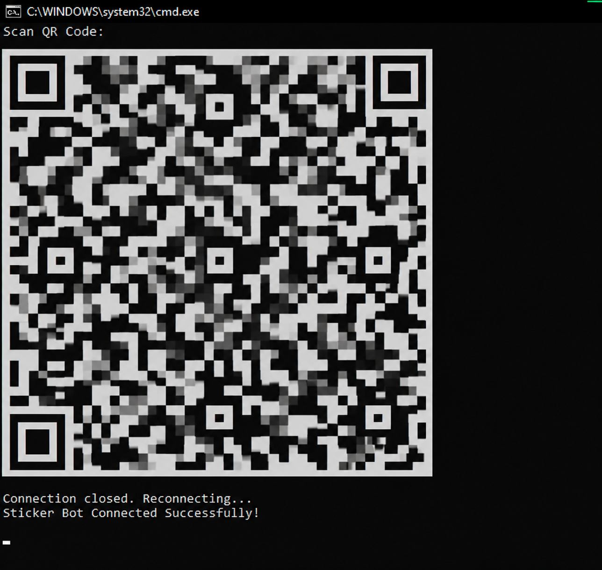
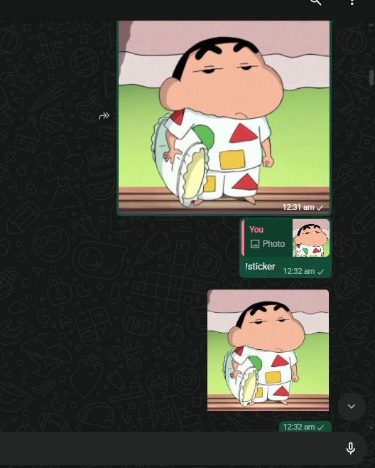
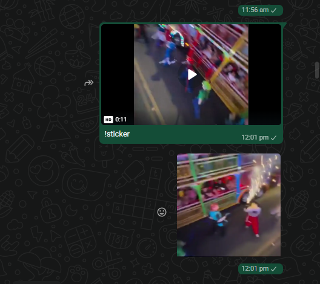
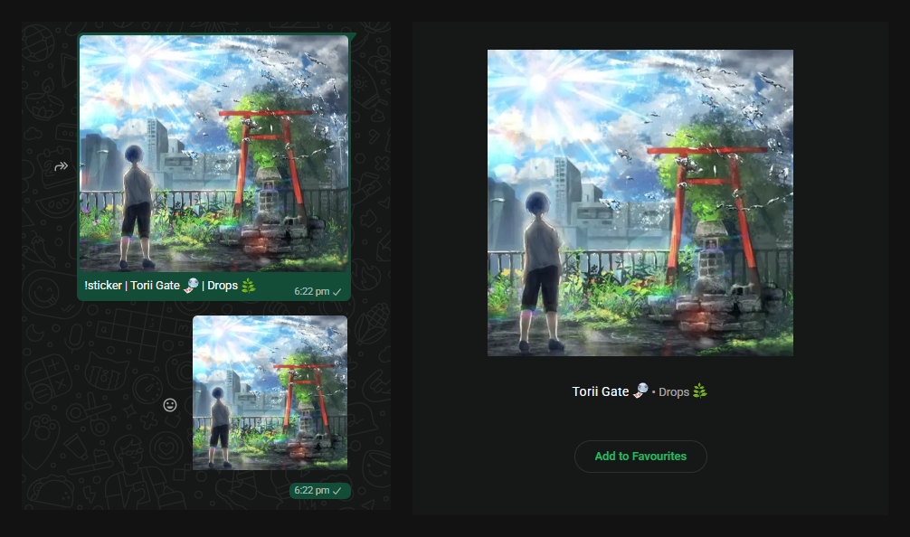
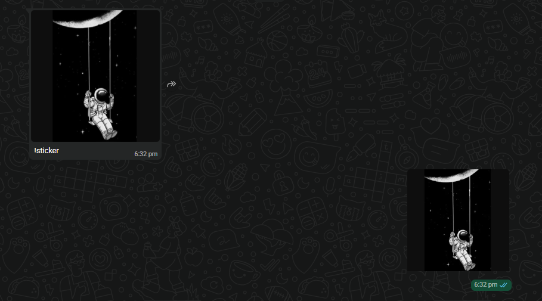

# 🚀 WhatsSticker

**A customizable WhatsApp Sticker Bot built with Node.js and Baileys.**

Convert images and videos into WhatsApp stickers, customize sticker pack names and authors, and update metadata on existing stickers — all through a simple WhatsApp command.

---

## ✨ Features

- 🖼️ **Image to Sticker:** Convert images into WhatsApp stickers.
- 🎥 **Video to Animated Sticker:** Convert videos into animated WebP stickers.
- 🔄 **Sticker Metadata Editor:** Update the pack name and author of existing stickers.
- 🏷️ **Custom Pack Name:** Set your own sticker pack name.
- ✍️ **Custom Author:** Personalize sticker author information.
- 📦 **Static & Animated Support:** Supports both static and animated WebP stickers.
- ⚡ **Automatic Compression:** Adjusts image quality to meet sticker size limits.
- 🧹 **Automatic Cleanup:** Removes temporary media files after processing.
- 🔐 **WhatsApp Authentication:** Uses Baileys multi-file authentication.

## 📸 Screenshots & Demonstration

### 1. Bot Connection
Scan the QR code using WhatsApp → Linked Devices → Link a Device.



### 2. Image to Sticker
Reply to any image with `!sticker` to convert it into a WhatsApp sticker.



### 3. Video to Animated Sticker
Convert video clips into animated WhatsApp stickers.



### 4. Custom Pack Name & Author
Customize the sticker pack name and author using `!sticker | Pack Name | Author Name`.



### 5. Friends Can Use the Bot
Your friends can also use the bot to create stickers!




## 🛠️ Built With

- [Node.js](https://nodejs.org/)
- [Baileys](https://github.com/WhiskeySockets/Baileys)
- [FFmpeg](https://ffmpeg.org/)
- [Fluent FFmpeg](https://github.com/fluent-ffmpeg/node-fluent-ffmpeg)
- [node-webpmux](https://www.npmjs.com/package/node-webpmux)

## 📥 Installation

### 1. Clone the repository

```bash
git clone https://github.com/star-bot-01/WhatsSticker.git
```

### 2. Enter the project directory

```bash
cd WhatsSticker
```

### 3. Install dependencies

```bash
npm install
```

### 4. Start the bot

```bash
node index.js
```

Alternatively, on Windows, you can use:

```bash
RunBot.bat
```

### 5. Connect WhatsApp

- Wait for the QR code in your terminal.
- Open WhatsApp on your phone.
- Go to Linked Devices.
- Scan the QR code.

Your sticker bot should now be connected!

## 🎮 Commands

### Create a sticker

Send an image or video with:

```text
!sticker
```

You can also reply to an image or video with this command.

### Customize sticker pack and author

```text
!sticker | My Sticker Pack | My Name
```

**Format:**

```text
!sticker | Pack Name | Author Name
```

If you don't provide custom values, the bot uses its default pack name and author.

### Update an existing sticker

1. Reply directly to an existing WhatsApp sticker.
2. Send:

```text
!sticker | New Pack | New Author
```

The bot will update the sticker metadata and send the updated sticker.

## ⚙️ Default Configuration

You can edit the default sticker settings inside `index.js`.

```javascript
const packName = 'Your Default Pack';
const authorName = 'Your Name';
```

Change these values to personalize your stickers.

## 📏 Sticker Processing Limits

| Type | Maximum Size |
|---|---:|
| Static Sticker | 100 KB |
| Animated Sticker | 480 KB |

Video conversion is configured for a maximum duration of 5 seconds.

The bot automatically adjusts quality to try to meet these limits.

## 📁 Project Structure

```text
WhatsSticker/
│
├── auth_info_baileys/   # WhatsApp session (local only)
├── node_modules/       # Dependencies (local only)
├── temp/               # Temporary media files
│
├── index.js             # Main bot source code
├── package.json         # Project dependencies
├── package-lock.json    # Dependency lock file
├── RunBot.bat           # Windows startup script
└── .gitignore           # Ignored files
```

## 🔐 Security Notice

- Never share your WhatsApp authentication folder.
- Never upload session credentials to GitHub.
- Keep personal tokens and private information out of the source code.
- The authentication directory is excluded through `.gitignore`.

## ⚠️ Disclaimer

This project is an independent, community-built WhatsApp automation project using Baileys. It is not affiliated with, endorsed by, or officially supported by WhatsApp or Meta.

Use responsibly and follow WhatsApp's applicable terms and policies.

## 👨‍💻 Author

**star-bot-01**

GitHub: [@star-bot-01](https://github.com/star-bot-01)

---

⭐ If you find this project interesting, consider starring the repository!

**Made with ❤️ and Node.js.**